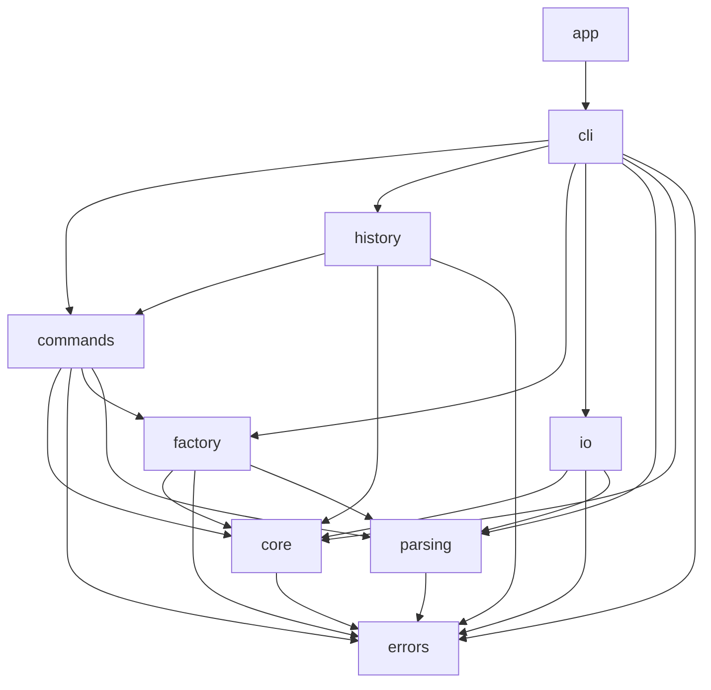
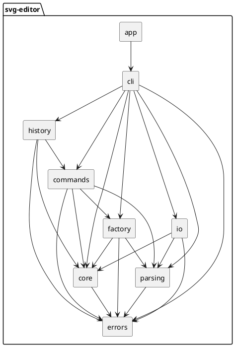

# SVG 编辑器（CLI）文档

以下是我对 Lab1 Phase 1 的架构方案、过程记录、一致性自查和质量保证的说明。

## 一、架构方案

### 1.1 模块划分

项目最终形成的目录结构如下。

```text
svg-editor/
├── src/
│   ├── app/
│   │   └── App.ts
│   ├── cli/
│   │   ├── CommandDispatcher.ts
│   │   ├── Repl.ts
│   │   └── TreeRenderer.ts
│   ├── commands/
│   │   ├── AddToCommand.ts
│   │   ├── BackCommand.ts
│   │   ├── CreateCommand.ts
│   │   ├── DeleteCommand.ts
│   │   ├── EditCommand.ts
│   │   ├── FrontCommand.ts
│   │   ├── GroupCommand.ts
│   │   ├── MoveCommand.ts
│   │   ├── ScaleCommand.ts
│   │   ├── SetCommand.ts
│   │   └── UngroupCommand.ts
│   ├── core/
│   │   ├── CircleShape.ts
│   │   ├── EllipseShape.ts
│   │   ├── GroupShape.ts
│   │   ├── LineShape.ts
│   │   ├── RectShape.ts
│   │   ├── Shape.ts
│   │   ├── SvgDocument.ts
│   │   └── TextShape.ts
│   ├── errors/
│   │   └── EditorError.ts
│   ├── factory/
│   │   └── ShapeFactory.ts
│   ├── history/
│   │   └── HistoryManager.ts
│   ├── io/
│   │   ├── SvgReader.ts
│   │   ├── SvgWriter.ts
│   │   └── XmlParser.ts
│   └── parsing/
│       ├── ParsedCommand.ts
│       └── Tokenizer.ts
├── tests/
│   ├── fixtures/
│   ├── integration/
│   └── unit/
│       ├── cli/
│       ├── commands/
│       ├── core/
│       ├── factory/
│       ├── history/
│       ├── io/
│       └── parsing/
├── doc/
│   └── README.md
├── package.json
└── tsconfig.json
```

各模块的职责如下。

1. `src/app` 是程序入口。它负责创建各个模块的实例，把它们组装起来，然后启动 REPL。这个目录不包含具体的编辑逻辑。
2. `src/cli` 是终端交互层。`Repl` 负责读取输入、输出结果和维护提示符；`CommandDispatcher` 负责识别命令名称并调用对应的处理逻辑；`TreeRenderer` 负责 `tree` 命令的树形排版。
3. `src/commands` 存放十个编辑命令。`EditCommand` 定义 `execute` 和 `undo` 两个抽象方法，每个具体命令类保存执行时需要的参数，并负责自己的撤销逻辑。
4. `src/history` 负责撤销和重做。`HistoryManager` 维护撤销栈和重做栈，并在执行文档类命令后锁定历史，直到下一条编辑命令成功执行。
5. `src/core` 是图形模型。`Shape` 是抽象基类，五种叶子图形和 `GroupShape` 继承它；`SvgDocument` 保存画布尺寸、根容器和全局 id 索引，并负责图形挂载和摘除时的索引维护。
6. `src/factory` 负责图形创建。`ShapeFactory` 根据类型名称创建具体图形，并检查参数个数和数字格式。
7. `src/parsing` 负责输入解析。`Tokenizer` 按空白拆分命令行并保留双引号内的空格；`ParsedCommand` 提取命令名、参数和末尾的 `in` 子句。
8. `src/io` 负责文件读写。`XmlParser` 解析 SVG 文本，`SvgReader` 把解析结果转换为 `SvgDocument`，`SvgWriter` 把文档输出为格式化的 SVG 文本。
9. `src/errors` 存放错误类型。`EditorError` 表示可以直接输出给用户的业务错误，命令模块和 IO 模块都使用它来报告失败。

下面是模块依赖图。箭头表示依赖方向。



对应的 PlantUML 组件图源文件如下。



### 1.2 设计模式的选择

我认为这个项目应当采用 Command 模式。这个项目的核心操作是编辑图形，而编辑命令需要支持撤销和重做，并且一条命令必须作为一个完整的撤销单元。Command 模式把每个操作封装成独立对象，正好满足这个要求。

代码中的落地方式分为四个部分。第一，`EditCommand` 是抽象基类，定义 `execute` 和 `undo` 两个方法。`execute` 修改文档并返回成功提示，`undo` 恢复执行前的状态并返回撤销提示。第二，十个编辑命令分别继承 `EditCommand`，包括创建、删除、移动、缩放、设置属性、分组、解散分组、加入容器、置顶和置底。每个命令类保存执行时需要的参数，例如移动命令保存 id、dx 和 dy，设置命令保存 id、属性名和新值。第三，`HistoryManager` 只依赖 `EditCommand` 抽象类，不依赖任何具体命令。它把执行成功的命令压入撤销栈，把撤销的命令压入重做栈。第四，重做不单独实现，而是再次调用命令的 `execute`，因为撤销已经把文档恢复到执行前的状态，命令参数也仍然保存在命令对象中。

各命令的撤销方式如下。

| 命令 | 撤销方式 |
|---|---|
| `create` | 摘除新建的图形，并从 id 索引中删除 |
| `delete` | 按原父容器和原位置挂回整棵子树 |
| `move` | 反向平移 |
| `scale` | 用执行前保存的几何状态还原 |
| `set` | 还原原属性值，原本不存在的属性恢复为不存在 |
| `group` | 成员回到原父容器和原位置 |
| `ungroup` | 重建容器并收回子节点 |
| `addto` | 回到原父容器和原位置 |
| `front` / `back` | 恢复原图层顺序 |

命令执行失败时不会修改状态。所有参数检查和结构检查都在修改数据之前完成，如果检查不通过就抛出 `EditorError`，`HistoryManager` 不会把失败的命令放入栈中。

另外，课程要求按名字分派只能出现在两个地方。我在 `ShapeFactory.create` 中按图形类型创建对象，在 `CommandDispatcher.dispatch` 中按命令名调用处理逻辑，其他位置没有按类型名或命令名分支。这两处都在代码注释中标注为后续重构点：图形工厂以后改为插件注册表，命令分发以后改为命令注册表。

### 1.3 依赖方向规则

我确定的依赖方向规则如下。第一，`core` 只依赖 `errors`，不能依赖 `io`、`cli` 或 `commands`。第二，`parsing` 只依赖 `errors`，不依赖图形模型。第三，`factory`、`commands` 和 `io` 只能依赖 `core`、`parsing` 和 `errors`，其中 `commands` 与 `io` 互不依赖。第四，`history` 只依赖 `EditCommand` 抽象类，不依赖具体命令。第五，`cli` 可以依赖除 `app` 以外的所有模块。第六，任何模块都不能反向依赖 `cli` 或 `app`。

这些规则的目的是让依赖从容易变化的模块指向稳定的模块。这样修改命令、文件格式或终端交互时，不会影响图形模型。

按照这些规则，我检查了 `src` 下全部 31 个 TypeScript 文件的 import 语句。检查结果是：`core` 只依赖 `errors`；`parsing` 只依赖 `errors`；`factory` 依赖 `core`、`parsing` 和 `errors`；`commands` 依赖 `core`、`parsing` 和 `errors`，其中 `CreateCommand` 还依赖 `factory`；`history` 依赖 `commands`、`core` 和 `errors`；`io` 依赖 `core`、`parsing` 和 `errors`；`cli` 依赖除 `app` 以外的所有模块；`app` 只依赖 `cli`。没有发现反向依赖，也没有发现 `commands` 和 `io` 互相引用。

### 1.4 变化点假设

1. 我认为最可能发生变化的地方是新增图形类型，尤其是后续阶段的 `box`。为此，我把所有类型创建集中在 `ShapeFactory` 中，并在代码注释里标明以后改为插件注册表。`SvgReader` 也会跳过不认识的标签及其子树，避免因为新增标签导致读取失败。

2. 第二个可能的变化是增加新的操作入口，例如图形界面或脚本调用。为此，我把编辑逻辑放在 `commands` 和 `history` 中，`cli` 只负责终端交互。以后增加新的操作入口时，可以复用这些命令，而不需要重新实现编辑逻辑。

3. 第三个可能的变化是修改 `tree` 或 `show` 的显示格式。为此，我让每个图形类自己提供 `describe` 和 `detail` 方法，`TreeRenderer` 只负责排版。修改显示内容时只需要改对应的图形类，修改排版时只需要改 `TreeRenderer`。

4. 第四个可能的变化是扩展 SVG 语法，例如支持 `transform`、样式表或更多元素。为此，我把读写逻辑集中在 `io` 模块。如果以后要支持 `transform`，需要在 `Shape` 层次补充坐标处理，但不需要修改命令和终端交互层。

5. 第五个可能的变化是调整撤销策略，例如支持事务级撤销或历史持久化。为此，我把栈操作集中在 `HistoryManager`。以后要修改撤销策略时，只需要修改这一个模块。

6. 我决定不为路径寻址预留实现。lab 明确说明本阶段不要求路径寻址，而改成路径寻址会影响所有命令的参数解析和图形查找逻辑，现在引入会增加不必要的复杂度。

7. 我决定不为多文档同时打开预留实现。本阶段的规格是单文档 REPL，`SvgDocument` 本身没有全局状态，以后需要时可以在应用层增加文档管理，不需要现在修改核心模型。

## 二、过程记录

下面的记录来自开发过程中的几次关键讨论，包含我当时的提问和 AI 的回答，以及我最后的处理方式。

**1. 容器移动和缩放采用哪种方式。** 在确定容器操作方案时，我问 AI：“d1和d4你觉得哪个方案好？”AI 的回答是：“D1：容器的 move/scale 采用递归改坐标……规范本身钦定了递归……如果使用 transform，tree 显示的位置和实际渲染位置会不一致。”我随后重新核对了 lab 文档，确认 `scale` 的定义确实要求把缩放系数乘到图形的全部几何属性，作用于容器时递归到每个子孙。最终我采用递归修改坐标，并在 `GroupShape` 的 `translate` 和 `scaleBy` 中递归调用所有子节点。

**2. IO 命令之后的历史栈。** 同一个问题里，AI 还回答了 D4，建议 `init` 和 `read` 清空历史栈并加锁，`save` 和 `canvas` 只加锁。AI 最初的方案是所有 IO 命令统一清空历史。我在实现 `HistoryManager` 时发现 `init` 和 `read` 会替换整个文档对象，旧命令引用会失效，而 `save` 和 `canvas` 不会替换文档对象。最终我按拆分方式实现，并为四种文档命令分别写了测试。

**3. 代码审计发现的两个缺陷。** 在完成第五个提交后，我问 AI：“现在检查一下当前的所有代码和提交里面和测试结果是否符合预期？现在是否有问题是否出现了问题，有问题则修复后提交。”AI 检查后报告了两个问题：`parseNumber` 使用 `Number(raw)` 会把空字符串转成 0，并且会接受 `0x10`、`Infinity` 和 `NaN`；`escapeXmlAttr` 没有转义 `<`，属性值里出现 `<` 时生成的 SVG 不合法。我确认这两个问题都存在，随后把数字解析改成严格的正则匹配，补齐了 XML 属性转义，并增加了回归测试。

**4. SvgReader 的重复注册。** 这个问题不是通过提问发现的，而是在 `save → read → save` 往返测试中出现 `id already exists` 后定位到的。AI 生成的初版 `SvgReader` 先递归导入 `g` 的子节点，再把 `g` 挂到父节点上，子节点已经注册过一次，父节点挂载时又把整棵子树注册一遍。我把顺序改成先挂载父节点、再递归处理子节点，问题消失。之后我补充了完整的会话回放测试，避免类似问题只靠单个模块的测试被漏掉。

**5. 文档结构和图的修正。** 在检查文档时，我向 AI 指出：“1.1部分的图展示是错误的”以及“设计模式你写了多个模式，为什么”。AI 随后把 1.1 的依赖图改成与实际 import 一致的版本，把 1.2 收窄为只回答 Command 模式，并在过程记录和一致性自查中补充了 AI 在实现过程中具体做了什么、有没有做好。我确认修改后的图与代码依赖一致，设计模式部分也不再并列列出多个模式。
## 三、一致性自查

**模块划分。** 方案阶段我计划把代码分成九个模块：`app`、`cli`、`commands`、`core`、`errors`、`factory`、`history`、`io` 和 `parsing`。实际目录与这个方案一致，九个目录都存在，没有新增、删除或改名。AI 在实现过程中按照这个划分生成了目录和初始文件，后续我在 `cli` 中增加了 `TreeRenderer`，在 `io` 中增加了 `XmlParser`，在 `core` 中增加了 `captureState`、`restoreState`、`visitSubtree`、`positionLabel` 和 `isAncestorOf` 等方法。这些改动都是在原有模块内部补充类和方法，没有改变模块边界，因此没有产生需要修订的模块级不一致。上述细化已经记录在本节中。

**依赖方向。** 方案阶段我确定的规则是：`core` 只依赖 `errors`；`parsing` 只依赖 `errors`；`factory`、`commands` 和 `io` 只依赖 `core`、`parsing` 和 `errors`；`history` 只依赖 `EditCommand` 抽象类；`cli` 可以依赖除 `app` 以外的模块；任何模块都不能反向依赖 `cli` 或 `app`。实现完成后，我检查了全部 31 个源文件的 import 语句，检查结果与这些规则一致，没有发现反向依赖，也没有发现 `commands` 和 `io` 互相引用。AI 在生成代码时基本遵守了这个划分，但在 `SvgReader` 的实现顺序上出现了问题，把子节点先注册了一次，父节点挂载时又注册一次，导致 id 重复。这个问题在集成测试中发现并修正，修正后依赖关系没有变化。按名分派只出现在 `ShapeFactory` 和 `CommandDispatcher` 两处，其他文件没有按图形类型或命令名的分支。

## 四、质量保证手段

我对功能完整性的判断主要依赖自动化测试，其次才是手动验证。具体做法如下。

- **单元测试。** 我使用 Vitest 编写了 27 个测试文件，共 155 个测试。测试覆盖图形类、文档模型、输入解析、图形工厂、十个编辑命令、历史管理和 SVG 读写。每个命令都测试成功执行、失败不修改状态、撤销还原和重做重放。

- **会话回放测试。** 我把 lab 第 6 节的完整会话、6.1 的中文流程图会话、`other.svg` 的读入和错误表写成集成测试。测试把命令逐行输入真实的 REPL，逐字符比较输出，包括 `svg> ` 提示符、`warning:` 和 `error:` 行，并检查保存出来的 SVG 文件内容。这部分测试是我确认功能与 lab 文档一致的主要依据。

- **类型检查。** 项目使用 TypeScript 的 strict 模式，另外启用了 `noUncheckedIndexedAccess`、`noImplicitOverride` 和 `noFallthroughCasesInSwitch`。每次提交前我都执行 `tsc --noEmit`，当前没有类型错误。

- **读写往返测试。** 我对同一份文档执行 `save → read → save`，比较两次输出是否完全一致。测试覆盖嵌套 `g`、样式属性、中文文本和小数坐标，输出达到字节级一致。

- **手动验证。** 我在真实终端中逐条执行 lab 会话，并用浏览器打开生成的 `demo.svg` 和 `flowchart.svg` 检查渲染效果。终端输出与 lab 文档一致，图形可以正常显示。

- **失败状态检查。** 我专门测试了命令抛出异常的情况，确认文档、历史栈和 IO 锁都不会发生变化。这样用户在终端输错命令时，不会留下修改了一半的状态。

- **依赖检查。** 我检查了所有源文件的 import 方向，确认依赖关系符合第 1.3 节的规则。按名分派只保留在 `ShapeFactory` 和 `CommandDispatcher` 两处。

- **依赖安全审计。** 我运行了 `npm audit`，报告显示 3 项告警，全部来自 `vitest` 及其测试依赖。编辑器运行时没有第三方依赖，报告建议的修复方式是降级到同样受影响的旧版本，所以我没有采用这个修复。

- **提交过程。** 我按模块拆分提交，每次提交前都执行类型检查和测试，确保每个提交都能独立编译并通过测试。提交历史可以反映从项目骨架到完整实现的开发过程。

总的来说，自动化测试覆盖了主要功能和边界情况，手动验证确认了终端输出和 SVG 渲染效果，类型检查和依赖检查保证了代码结构和接口的稳定性。目前我没有发现已知的功能缺口。

