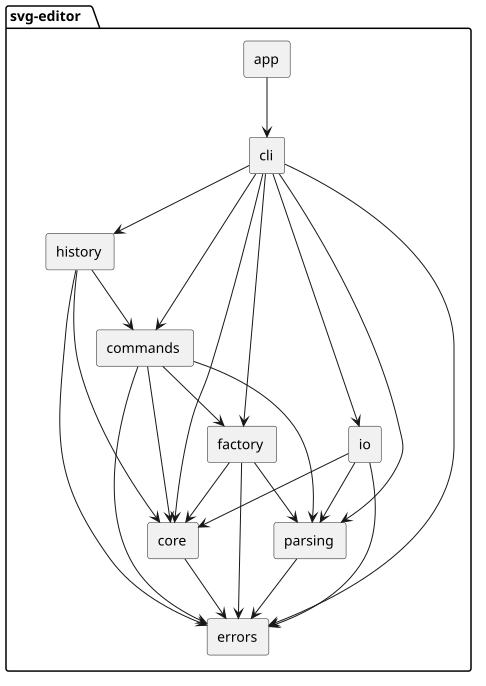

## 一、架构方案

### 1.1 模块划分

项目目录结构如下

```text
svg-editor/
├── src/
│   ├── app/
│   │   └── App.ts
│   ├── cli/
│   │   ├── CommandDispatcher.ts
│   │   ├── Repl.ts
│   │   └── TreeRenderer.ts
│   ├── commands/
│   │   ├── AddToCommand.ts
│   │   ├── BackCommand.ts
│   │   ├── CreateCommand.ts
│   │   ├── DeleteCommand.ts
│   │   ├── EditCommand.ts
│   │   ├── FrontCommand.ts
│   │   ├── GroupCommand.ts
│   │   ├── MoveCommand.ts
│   │   ├── ScaleCommand.ts
│   │   ├── SetCommand.ts
│   │   └── UngroupCommand.ts
│   ├── core/
│   │   ├── CircleShape.ts
│   │   ├── EllipseShape.ts
│   │   ├── GroupShape.ts
│   │   ├── LineShape.ts
│   │   ├── RectShape.ts
│   │   ├── Shape.ts
│   │   ├── SvgDocument.ts
│   │   └── TextShape.ts
│   ├── errors/
│   │   └── EditorError.ts
│   ├── factory/
│   │   └── ShapeFactory.ts
│   ├── history/
│   │   └── HistoryManager.ts
│   ├── io/
│   │   ├── SvgReader.ts
│   │   ├── SvgWriter.ts
│   │   └── XmlParser.ts
│   └── parsing/
│       ├── ParsedCommand.ts
│       └── Tokenizer.ts
├── tests/
│   ├── fixtures/
│   ├── integration/
│   └── unit/
│       ├── cli/
│       ├── commands/
│       ├── core/
│       ├── factory/
│       ├── history/
│       ├── io/
│       └── parsing/
├── doc/
│   └── README.md
├── package.json
└── tsconfig.json
```

最终划分成了 9 个模块，各模块的职责如下。

1. `src/app` 是程序的启动模块。它负责创建各个模块的实例、完成依赖组装并启动命令行界面，不处理具体的编辑逻辑。

2. `src/cli` 是命令行交互模块。它负责读取用户输入、识别命令并调用对应的处理逻辑，同时把执行结果输出到终端

3. `src/commands` 是编辑命令模块。每个命令封装成独立的类，保存执行所需的数据，并通过 `execute` 和 `undo` 完成执行与撤销。

4. `src/history` 是撤销重做模块。它维护撤销栈和重做栈，并控制文档类命令执行后历史功能何时被锁定和解锁。

5. `src/core` 是图形模型模块。它定义图形基类、具体图形、容器和画布文档，并维护图形之间的层级关系以及全局 id 索引。

6. `src/factory` 是图形创建模块。它根据类型名称生成对应的图形对象，并检查参数数量和数字格式是否合法。

7. `src/parsing` 是输入解析模块。它把一行命令拆分成命令名、参数和 `in` 子句，并正确处理双引号中的空格。

8. `src/io` 是文件读写模块。它负责解析SVG文本、把解析结果转换为文档对象，以及把文档对象输出为格式化的 SVG 文件。

9. `src/errors` 是错误定义模块。它提供统一的业务异常类型，让命令和 IO 模块能够用一致的方式向命令行报告失败原因。

下面是模块依赖，箭头表示依赖方向。



### 1.2 设计模式的选择

本项目采用的是Command模式，这个项目的核心操作是编辑图形，而编辑命令需要支持撤销和重做，并且一条命令必须作为一个完整的撤销单元。Command 模式把每个操作封装成独立对象

代码中分为四个部分：

1. `EditCommand` 是抽象基类，定义 `execute` 和 `undo` 两个方法。`execute` 修改文档并返回成功提示，`undo` 恢复执行前的状态并返回撤销提示
2. 10个编辑命令分别继承 `EditCommand`，每个命令类保存执行时需要的参数
3. `HistoryManager` 只依赖 `EditCommand` 抽象类，不依赖任何具体命令。它把执行成功的命令压入撤销栈，把撤销的命令压入重做栈。
4. 重做不单独实现，而是再次调用命令的 `execute`，因为撤销已经把文档恢复到执行前的状态，命令参数也仍然保存在命令对象中。

各命令的撤销方式如下

| 命令 | 撤销方式 |
|---|---|
| `create` | 摘除新建的图形，并从 id 索引中删除 |
| `delete` | 按原父容器和原位置挂回整棵子树 |
| `move` | 反向平移 |
| `scale` | 用执行前保存的几何状态还原 |
| `set` | 还原原属性值，原本不存在的属性恢复为不存在 |
| `group` | 成员回到原父容器和原位置 |
| `ungroup` | 重建容器并收回子节点 |
| `addto` | 回到原父容器和原位置 |
| `front` / `back` | 恢复原图层顺序 |

命令执行失败时不会修改状态。所有参数检查和结构检查都在修改数据之前完成，如果检查不通过就抛出 `EditorError`，`HistoryManager` 不会把失败的命令放入栈中

### 1.3 依赖方向规则

项目依赖规则如下：

- `core` 只依赖 `errors`。`core` 是最底层的图形模型

- `parsing` 只依赖 `errors`。解析层只负责把一行输入拆成命令名和参数

- `factory` 只依赖 `core`、`parsing` 和 `errors`。图形工厂需要创建具体的图形对象，并使用解析层提供的数字转换，因此依赖这两个模块

- `io` 只依赖 `core`、`parsing` 和 `errors`。文件读写需要构造和遍历图形对象，也需要解析数字属性，因此依赖图形模型和解析层

- `commands` 依赖 `core`、`parsing`、`errors` 和 `factory`，编辑命令需要操作图形、解析参数并创建新图形，但不需要知道文件格式，这样命令逻辑和文件读写可以分别修改

- `history` 依赖 `commands` 中的 `EditCommand` 抽象类，以及 `core` 和 `errors`。历史管理只关心命令的执行和撤销，不需要知道具体是创建、移动还是删除命令

- `cli` 可以依赖除 `app` 以外的所有模块，`app` 只依赖 `cli`。`cli` 是终端交互层，`app` 只负责组装和启动，不参与具体逻辑

- 任何模块都不能反向依赖 `cli` 或 `app`

按规则检查后没有反向依赖的情况

### 1.4 变化点假设

1. 图形类型会发生变化。 以后可能要增加 `box`、`polygon` 这类新图形。现在已经把类型创建集中在 `ShapeFactory` 中，并在注释里标明以后改为插件注册表，`SvgReader` 也会跳过不认识的标签及其子树，避免读取文件时因为多一个标签而失败
2. 操作入口会发生变化。 如果要会增加图形界面或脚本调用，编辑逻辑已经集中在 `commands` 和 `history` 中，`cli` 只负责终端交互。新的入口可以复用同一批命令，不需要重新实现编辑逻辑
3. SVG相关操作元素等发生变化。 以后可能会支持 `transform`、样式表或更多SVG 元素，读写逻辑已经集中在 `io` 模块，普通元素和属性的扩展可以在这一层完成，如果要支持 `transform`，还需要在 `Shape` 层次补充坐标处理，但不需要修改命令和终端交互层
4. 编辑命令会发生变化， 以后可能增加旋转、复制、对齐等新的编辑命令。现在所有命令都继承 `EditCommand`，由 `HistoryManager` 统一处理撤销和重做，新增命令只需要新增命令类并在 `CommandDispatcher` 中注册，不需要修改图形模型
## 二、过程记录

1. 关于模块划分。 项目开始时，ai建议把命令解析、命令执行、文档管理和 REPL 都放进一个 Editor 类，理由是代码集中、实现速度快。但这种后续增加命令或修改文件格式时很难维护。之后我让ai拆分为多个模块，并人工指定一些模块，如 `core`、`commands`、`factory`、`errors` 和 `app` ，ai根据我的要求，最终生成了9个模块，根据这9个模块，再让ai根据这个结构生成框架代码，后续实现中虽然增加了一些类，但没有出现模块级返工
2. 关于io命令后的历史策略。ai最开始建议所有文档类命令执行后都清空历史栈。其中`init` 和 `read` 会替换整个文档对象，清空是必要的，但 `save` 只是写文件，`canvas` 只修改尺寸，文档对象没有变化，清空会丢失本来可以继续使用的撤销记录。最终我决定把策略拆开：`init` 和 `read` 清空两个栈并加锁，`save` 和 `canvas` 只加锁，后面让ai实现并验证
3. svg的读取顺序部分， ai生成的 `SvgReader` 初版先递归导入 `g` 的子节点，再把 `g` 挂到父节点上。单看 reader的测试没有发现问题，但在 `save → read → save` 往返测试中出现了 `id already exists`。我判断原因是子节点先注册了一次，父节点挂载时整棵子树又注册一次。我要求把顺序改成先挂载父节点、再递归处理子节点，并补充了会话回放测试，避免只靠单个模块的测试漏掉组合问题。
4. 测试中间的自检，做到第五个提交后，我没有继续增加功能，而是让 AI 对已有代码做一次整体检查。检查发现两个问题：数字解析直接使用 `Number(raw)`，空字符串会变成 0，还会接受 `0x10`、`Infinity` 和 `NaN`；XML 属性转义漏掉了 `<`，属性值里出现 `<` 时生成的 SVG 不合法。我确认这些问题会影响实际输入和文件输出，决定把数字解析改成严格的正则匹配，把 `<` 和 `>` 补进属性转义，并为这两种情况增加回归测试

## 三、一致性自查

**模块划分。** 在方案的部分我设计了九个模块：`app`、`cli`、`commands`、`core`、`errors`、`factory`、`history`、`io` 和 `parsing`。在过程中先让ai按照模块去把整体框架架构搭起来，再让里面填充内容，所以实际目录与这个方案一致

**依赖方向。** 方案里确定的规则让ai去实现后，经过检查，最终的结果与这些规则一致。ai在生成代码时基本遵守了这个划分，但在 `SvgReader` 的实现顺序上出现了问题，把子节点先注册了一次，父节点挂载时又注册一次，导致id重复。这个问题在集成测试中发现并修正，修正后依赖关系没有变化

## 四、质量保证手段

- **单元测试。** 我要求ai按模块补测试，ai最终写了27个测试文件、155 个用例，覆盖图形类、文档模型、解析、工厂、十个命令、历史管理和 IO。每个命令都分别测试了正常执行、参数错误、撤销还原和重做

- **端到端会话测试。** 让ai把lab文档里的完整会话做成集成测试，测试把命令逐行输入真实 REPL，逐字符比较 `svg> ` 提示符、`warning:` 和 `error:` 行，并检查保存出来的 SVG 内容

- **类型检查。** 项目一开始就开了 TypeScript 的 strict 模式，后面又加了 `noUncheckedIndexedAccess`、`noImplicitOverride` 和 `noFallthroughCasesInSwitch`。我要求 AI 在每次提交前执行 `tsc --noEmit`，出现类型错误必须改代码

- **手工验收。** 除了自动测试，我自己在终端里运行了这个项目，自己自定义运行了一些示例并检查相关的svg是否显示正常。如果发现有问题的地方，给ai指出问题让ai去修改

- **代码审查。** 每次完成几个大的模块之后，我都先让ai先暂停继续做，让它审计测试一下之前写的代码，是否满足文档要求，是否满足方案要求，代码中还有什么错误等等，然后让它修改，避免某一部分对之后的内容产生影响

- **依赖与结构检查。**让ai去审查和检查了每一部分的依赖是否按照要求和方案去做

- **提交与回归。** 让ai按模块分步提交，每次提交前都跑类型检查和测试，避免把不能编译的状态推到远程。整个开发过程按模块拆成多次提交，每次都能单独通过检查，出问题时也容易定位到是哪一步引入的
