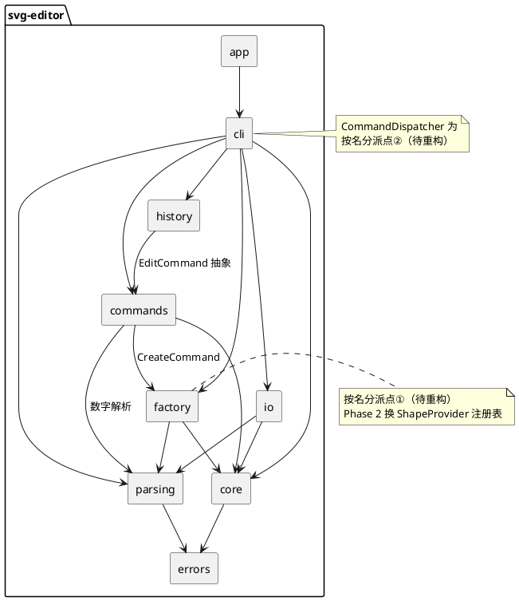

# SVG 编辑器（CLI）— 架构文档

> Lab1 Phase 1 ｜ TypeScript + 面向对象 ｜ Command 模式（强制）+ Composite + Factory

## 一、架构方案

### 1.1 模块划分

| 模块（目录） | 职责 | 关键类 |
|---|---|---|
| `src/core` | 纯领域模型：图形层次、画布、全局 id 索引；不关心 IO 与交互 | `Shape`（抽象基类）、`RectShape` / `CircleShape` / `EllipseShape` / `LineShape` / `TextShape` / `GroupShape`、`SvgDocument` |
| `src/errors` | 统一业务异常，消息体即 CLI 输出（去掉 `error:` 前缀后的部分） | `EditorError` |
| `src/parsing` | 引号感知分词与命令行结构化（命令名、参数、`in` 子句、注释过滤）；不接触领域对象 | `Tokenizer`（函数）、`ParsedCommand` |
| `src/factory` | 类型名 → 图形实例的创建与参数校验；**按名分派点①，待重构**（见 1.2.4） | `ShapeFactory` |
| `src/commands` | 十个编辑命令，Command 模式载体；每命令自带执行/逆操作所需信息 | `EditCommand`（抽象）、`CreateCommand` / `DeleteCommand` / `MoveCommand` / `ScaleCommand` / `SetCommand` / `GroupCommand` / `UngroupCommand` / `AddToCommand` / `FrontCommand` / `BackCommand` |
| `src/history` | undo/redo 双栈 + IO 锁；只认识 `EditCommand` 抽象，不认识具体命令 | `HistoryManager` |
| `src/io` | SVG 文本 ↔ 领域对象：XML 解析（含实体/注释）、缺 id 补全与警告、未知标签跳过、格式化输出 | `XmlParser`、`SvgReader`、`SvgWriter` |
| `src/cli` | 最外层翻译层：REPL 循环、命令名分派（**按名分派点②，待重构**）、树形显示布局、文件系统访问 | `Repl`、`CommandDispatcher`、`TreeRenderer` |
| `src/app` | 组装根：构造各模块并启动 REPL | `App` |



### 1.2 设计模式的选择与落地

#### 1.2.1 Command 模式（本 lab 强制要求）

**为什么**：十条编辑命令需要"执行 + 精确撤销 + 重做"，且"一条命令 = 一个 undo 单元"；把命令封装为对象是唯一能让 HistoryManager 对所有编辑一视同仁的方式。

**落地**：

```ts
export abstract class EditCommand {
  abstract execute(doc: SvgDocument): string;  // 执行并返回成功反馈
  abstract undo(doc: SvgDocument): string;     // 逆操作并返回撤销反馈
  // redo = 重放 execute：undo 已恢复前置状态，参数固化在命令对象中
}
```

每个命令的逆操作策略（均被单测覆盖）：

| 命令 | execute 关键行为 | undo 策略 |
|---|---|---|
| create | 校验 id 唯一 → 工厂构造 → 挂入 `in` 容器或根 | detach 并注销子树 |
| delete | 记录 (parent, index) → 摘除整棵子树 | **按原 index 原位挂回**（保 z-order） |
| move | 叶子递归平移自身、容器递归全部子孙 | 反向位移 |
| scale | factor>0 校验 → 快照整棵子树状态 → 递归缩放 | **快照精确还原**（不乘 1/f，杜绝浮点漂移） |
| set | 白名单校验 → 快照 → 赋值 | 快照还原；"新设属性"撤销后回到 unset |
| group | 成员两两非祖孙校验 → 按参数顺序收编 | 各成员回原 (parent, index)，同父按 index 升序还原 |
| ungroup | 子节点提升到父级、占据 g 原位置 | 重建 g 并按原顺序收回子节点 |
| addto | 目标为容器且非自身子孙 → 挂为末子 | 回原父原 index |
| front / back | 调整同级 z-order（SVG 后绘制在上） | 回原 index |

**失败原子性**：所有校验先于任何状态变更，命令抛 `EditorError` 时文档与历史栈零变化。

#### 1.2.2 Composite 模式

`GroupShape` 与五种叶子统一继承 `Shape`，以下操作对容器与叶子完全一致：

- `translate` / `scaleBy`：容器递归到每个子孙（对应 lab "作用于容器时整体平移/递归缩放"）；
- `visitSubtree`：深度优先遍历，scale 快照、树形显示共用；
- `isAncestorOf`：环检测（group/addto 的"容器与其子孙"校验）；
- `describe` / `detail` / `toXml`：多态展示与序列化，外部代码零 `switch(tag)`。

`SvgDocument.attach/detach/insert` 维护 `Map<id, Shape>` 全局索引，对**整棵子树**递归注册/注销，保证 id 全局唯一约定。

#### 1.2.3 多态序列化（消灭 switch(tag) 的关键）

每种图形自己负责：`describe()`（tree 内联摘要）、`detail()`（show 明细）、`toXml()`（SVG 片段）。`TreeRenderer` 只做布局（分支符/缩进/对齐），`SvgWriter` 只拼根元素——二者不含任何图形类型判断。

#### 1.2.4 Factory 模式与两处"允许的按名分派"

按 lab 约定，按名字分派只允许两处，均已集中并在代码注释标注**待重构**：

| 分派点 | 位置 | 现状 | 重构方向 |
|---|---|---|---|
| ① 图形工厂（类型名 → 类） | `ShapeFactory.create` | 六种内置类型 switch | Phase 2 换 `ShapeProvider` 注册表插槽；`box` 等复合图形以插件注册，内核新增代码为 0 |
| ② 命令分发（命令名 → 实现） | `CommandDispatcher.dispatch` | 十九个命令名 switch | 若出现动态命令注册需求（脚本/插件），改为命令注册表 |

除这两处外，代码中不存在按图形类型或命令名的字符串分派（属性分派在各 Shape 类内部，属于"属性的所有者自己处理"，非跨类型 switch）。

#### 1.2.5 状态快照机制（scale/set 精确撤销的支撑）

`Shape.captureState() / restoreState()` 以固定顺序记录几何数值 + 样式 + 文本内容。这不是经典 GoF Memento 的全量文档快照，而是**最小粒度、按 Shape 多态**的状态捕获：既避免乘 `1/f` 的浮点误差，又不需要克隆整棵树。

### 1.3 依赖方向规则

**规则**（箭头 = 允许依赖）：

1. `core` 为最稳定内核，仅依赖 `errors`，**禁止依赖任何其他模块**；
2. `parsing` 独立于领域，仅依赖 `errors`；
3. `factory` / `commands` / `io` 只向下依赖 `core` / `parsing` / `errors`，**三者之间禁止互相依赖**；
4. `history` 仅依赖 `commands` 的 `EditCommand` 抽象，不依赖任何具体命令；
5. `cli` 是最外层翻译层，可依赖除 `app` 外的一切；`app` 只被入口使用；
6. **任何模块禁止反向依赖 `cli` / `app`**；`core` 禁止依赖 `io`（文件读写只在 io/cli，图形自带的 `toXml` 是领域自描述，不是文件 IO）。

**理由**：稳定度排序 `core > errors/parsing > factory/commands/io/history > cli > app`。依赖只能从多变指向稳定，这样命令、IO、交互通道任何一个变化都不会波及内核。

**实测审计**（对全部 31 个源文件的 import 语句扫描，2026-10-24）：

| 文件 | 实际依赖 | 判定 |
|---|---|---|
| core/* | errors | ✅ |
| parsing/* | errors | ✅ |
| factory/ShapeFactory | core, errors, parsing | ✅ |
| commands/*（10 文件） | core, errors, parsing, factory（仅 CreateCommand） | ✅ |
| history/HistoryManager | commands, core, errors | ✅ |
| io/* | core, errors, parsing | ✅ |
| cli/* | commands, core, errors, factory, history, io, parsing | ✅ |
| app/App | cli | ✅ |

**结论：零违规。** commands ↔ io、core → io、cli 被反向依赖等禁止路径均未出现。

### 1.4 变化点假设

| # | 变化点（按概率排序） | 为它留了什么 | 或为什么不留 |
|---|---|---|---|
| 1 | **新增图形类型**（Phase 2 的 `box` 复合图形插件） | `ShapeFactory` 已把类型枚举压缩到一处并标注待重构；`SvgReader` 未知标签整树跳过 + `data-kind` 还原语义已在 lab 定义，插槽方向明确 | — |
| 2 | **新增交互通道**（GUI / agent 复用同一批命令） | 全部编辑逻辑在 `commands` + `history`，与终端零耦合；`cli` 只是翻译层，换 UI 只换翻译层 | — |
| 3 | **显示格式变化**（tree/show 排版、更多信息） | `describe/detail` 多态 + `TreeRenderer` 布局分离，改排版不动领域，改内容在各类内部 | — |
| 4 | **SVG 语法扩展**（transform、样式表、更多元素） | 读写集中在 `io`；reader 已容错未知元素；若引入 transform 需扩展 Shape 层的坐标语义（属领域决策，不是 IO 问题） | — |
| 5 | **历史策略变化**（分组 undo、持久化历史） | `HistoryManager` 独立成模块，栈语义集中一处 | — |
| 6 | id 寻址换成路径寻址（如 `/canvas/g1/rect[2]`） | 不留 | lab 明确声明本阶段不要求；预留会显著复杂化所有命令，违背 YAGNI |
| 7 | 多文档同时打开 | 不留 | 单文档 REPL 是规格边界；`SvgDocument` 本身无全局状态，未来扩展成本低 |

---

## 二、过程记录

以下为开发中真实发生的关键讨论与迭代（按时间序），包括从 AI 建议中发现问题并纠正的过程。

### 2.1 决策 D1：容器 move/scale 采用"递归改坐标"而非 transform

AI 最初给出两个方案。核对 lab 原文发现 `scale` 的定义已经写明"factor 同乘到图形的全部几何属性（位置与尺寸）；作用于容器时递归到每个子孙"——规范本身钦定了递归。进一步论证：若用 `transform`，tree 内联属性将与渲染位置不一致（违反"脱离画布工作"的设计目标）、`set` 子元素属性需要矩阵逆运算、读回需组合 transform 链。**结论：递归改坐标，无悬念。**

### 2.2 决策 D4：IO 命令后的历史栈——两个一刀切方案都有硬伤

lab 要求"文档类命令后 undo/redo 禁止，直到下一次编辑命令重新解禁"。AI 初版方案是"所有 IO 一律清栈"，讨论中发现：`init/read` 替换整个文档对象，旧命令引用悬空，**必须**清栈（正确性 bug）；但 `save` 根本不改文档、`canvas` 只改两个字段，清栈会无谓毁掉撤销历史且与"重新解禁"语义不符。**修正为拆分策略**：init/read = 清栈+锁；save/canvas = 只锁。这是本项目最重要的一次"对 AI 方案纠错"。

### 2.3 第一轮全面审计（commit 5 后）发现两个真实缺陷

1. `parseNumber` 用 `Number("")` 得 0——空字符串坐标被静默接受；`0x10`/`Infinity`/`NaN` 同样被收。修正为严格十进制正则（允许符号/整数/小数/科学计数法），core 与 parsing 双处同步收紧，补 6 个回归测试。
2. `escapeXmlAttr` 未转义 `<`（XML 属性值非法字符），含 `<` 的 id/stroke 会产出浏览器无法打开的文件。补齐转义并加回归测试。

### 2.4 SvgReader 的双重注册 bug

初版 reader 先递归导入 `g` 的子节点、再把 `g` 挂回父级——子节点已先注册进索引，父级 `attach` 走子树注册时同一 id 注册两次，报 `id already exists`。**修正为自顶向下：先挂父、再递归子。** 该 bug 由集成测试暴露，说明"reader 单测通过 ≠ 组装正确"。

### 2.5 XML 文本实体漏反转义

属性值做了实体反转义，文本内容最初没有做——`a &amp; b` 读回显示为字面 `&amp;`。修正：元素闭合时对累计文本统一反转义。同一轮还修掉了：无宽高时默认值写死 800×800（应为 800×600）、REPL 在非 TTY 流上 readline 不输出 prompt（改为手动写 `svg> `，顺带让管道回放测试成为可能）。

### 2.6 对 lab 规范的取舍：ungroup 顶层容器

直觉上"解散 svg 直接子级的 g"是常见需求，但 lab 4.2 明确列出 `error: cannot ungroup top-level container`。经讨论按规范字面实现并在 help/本文档记录——**规范一致性优先于个人直觉**，该行为已被错误表测试锁定。

### 2.7 tree 对齐的确定化

lab 示例中的手工对齐在不同行并不自洽（同样是根级，`rect#bg` 后 8 空格、`text#title` 后 5 空格）。实现采用确定性规则："同一父级下最长标签 + 2 空格"，输出对齐且可测试；集成测试以本算法输出为准做逐字节断言。

### 2.8 文档定位的纠正（用户 review）

用户指出仓库缺少 GitHub 门面 README，且初版混入了开发进度表、课程要求等过程性内容。修正为双文档定位：根 `README.md` 只做标准项目介绍；本文件（`doc/README.md`）承载课程要求的过程性内容。另有一次提交范围瑕疵（README commit 捎带了 factory 占位文件删除）被记录，此后提交一律显式指定文件。

### 2.9 会话回放驱动的收口

Commit 10 将 lab 第 6 节会话、6.1 流程图会话（中文）、other.svg 读入、4.2 错误表全部做成**逐字节回放测试**。此举把"实现看起来对"升级为"输出与规范逐字符一致"，是最终质量信心的主要来源。

---

## 三、一致性自查

### 3.1 模块划分：实际目录与方案是否一致？

**一致。** 实际目录 `app / cli / commands / core / errors / factory / history / io / parsing` 与 1.1 方案逐项对应，测试目录 `tests/unit/{core,parsing,factory,commands,history,io,cli}` + `tests/integration` 与模块一一配套。

**细化记录**（方案粒度之下的实现细节，不构成偏离）：

- `cli` 内细化为三个类：`Repl`（循环）、`CommandDispatcher`（分派+会话状态）、`TreeRenderer`（树布局）；
- `io` 内细化为 `XmlParser` / `SvgReader` / `SvgWriter` 三类；
- `core` 在 commit 5 为支撑命令撤销新增 `captureState/restoreState/visitSubtree/positionLabel/isAncestorOf` 等多态成员——属实现需要的方法补全，模块边界未变。

**修订记录**：无模块级增删改名。

### 3.2 依赖方向：方案规则有没有被违反？

**没有。** 以 1.3 的六条规则对照 2.4 节的实测 import 表：`core` 仅依赖 `errors`；`commands` 与 `io` 互不依赖；`history` 仅引用 `EditCommand` 抽象；无任何模块反向依赖 `cli/app`。两处计划内的按名分派（ShapeFactory、CommandDispatcher）保持集中并标注待重构，未在别处扩散。

---

## 四、质量保证手段

| 手段 | 说明 | 结果 |
|---|---|---|
| 单元测试 | 27 个测试文件覆盖 core/parsing/factory/commands/history/io/cli；每个命令 × {成功反馈、失败不变态、undo 精确还原、redo 重放} | 155 通过 / 0 失败 |
| 会话回放集成测试 | lab 第 6 节会话、6.1 流程图会话（中文 + in 子句）、other.svg 读入、4.2 错误表共 4 场景，**完整输出逐字节断言**（含提示符与错误行），并校验写出的 SVG 文件内容 | 全部通过 |
| 严格类型检查 | `tsc --noEmit`，strict + `noUncheckedIndexedAccess` + `noImplicitOverride` + `noFallthroughCasesInSwitch` | 零错误 |
| Round-trip 验证 | `save → read → save` 字节级一致（含实体、嵌套 g、g 样式、小数坐标） | 通过 |
| 真实 CLI 手动验证 | 交互式终端逐条执行 lab 会话 + 中文文本 + 浏览器打开 demo.svg/flowchart.svg | 通过 |
| 失败原子性测试 | 命令抛错时文档、历史栈、锁状态零变化 | 覆盖 |
| 依赖审计 | npm audit：3 项告警全部位于 vitest 开发测试链（本项目运行时零依赖），上游无可升级修复 | 评估后接受 |
| 提交过程 | 12 个主题化提交，每步可编译、当步测试全绿、当天推送 | 历史完整 |

**结论**：功能完整性由"lab 原文 transcript 逐字节回放"直接证明；代码质量信心来自严格类型 + 单元/集成双层测试 + 失败原子性约束 + 依赖规则零违规。
