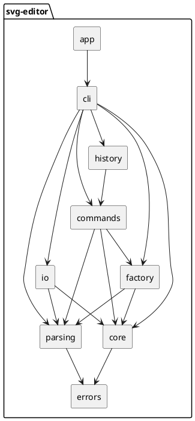

# SVG 编辑器（CLI）架构文档

这份文档记录我在 Lab1 Phase 1 中的架构设计、开发过程、一致性检查和质量保证。项目使用 TypeScript，按面向对象方式组织代码，编辑命令使用 Command 模式实现撤销与重做。

## 一、架构方案

### 1.1 模块划分

项目按职责分为九个模块，各模块的职责和主要类如下。

| 目录 | 职责 | 主要类 |
|---|---|---|
| `src/core` | 图形层次、画布和 id 索引 | `Shape`、五种叶子图形、`GroupShape`、`SvgDocument` |
| `src/errors` | 统一的业务异常 | `EditorError` |
| `src/parsing` | 命令行分词与参数结构解析 | `Tokenizer`、`ParsedCommand` |
| `src/factory` | 按类型名创建图形并校验参数 | `ShapeFactory` |
| `src/commands` | 十个编辑命令 | `EditCommand` 及十个命令类 |
| `src/history` | 撤销栈、重做栈和 IO 命令后的历史锁定 | `HistoryManager` |
| `src/io` | SVG 文本与文档对象之间的转换 | `XmlParser`、`SvgReader`、`SvgWriter` |
| `src/cli` | 终端交互、命令分发和树形显示 | `Repl`、`CommandDispatcher`、`TreeRenderer` |
| `src/app` | 模块组装与程序入口 | `App` |

### 1.2 设计模式

**Command 模式。** 编辑命令统一继承 `EditCommand`，实现 `execute` 和 `undo`。`HistoryManager` 只依赖这个抽象类，维护撤销栈和重做栈。重做时重新调用 `execute`，命令参数保存在命令对象中，撤销后文档已回到执行前状态。

| 命令 | 撤销方式 |
|---|---|
| `create` | 摘除新建的图形，并从 id 索引中删除 |
| `delete` | 按原父容器和原位置挂回整棵子树 |
| `move` | 反向平移 |
| `scale` | 用执行前保存的几何状态还原 |
| `set` | 还原原属性值，原本不存在的属性恢复为不存在 |
| `group` | 成员回到原父容器和原位置 |
| `ungroup` | 重建容器并收回子节点 |
| `addto` | 回到原父容器和原位置 |
| `front` / `back` | 恢复原图层顺序 |

命令的所有检查都在修改数据之前完成。命令抛出 `EditorError` 时，文档和历史栈不发生变化。

**Composite 模式。** `GroupShape` 和五种叶子图形继承同一个 `Shape` 基类。移动、缩放、删除、显示和序列化通过统一接口调用。`GroupShape` 的平移和缩放递归作用于子节点；`SvgDocument` 在挂载和摘除图形时递归维护整棵子树的 id 索引。

**Factory 模式。** `ShapeFactory` 负责类型名到具体类的映射和参数校验。课程允许的两处按名分派分别位于 `ShapeFactory.create` 和 `CommandDispatcher.dispatch`，代码中已标明后续重构方向。其他位置不按图形类型或命令名分支。

**显示与序列化。** 每种图形实现 `describe`、`detail` 和 `toXml`，分别用于 `tree`、`show` 和保存。`TreeRenderer` 只负责排版，`SvgWriter` 只负责根元素。

### 1.3 依赖方向规则

依赖只能从容易变化的模块指向稳定的模块，这样修改命令、文件格式或交互方式时，不会影响图形模型。

1. `core` 只依赖 `errors`，不依赖 `io`、`cli` 或 `commands`。
2. `parsing` 只依赖 `errors`，不依赖图形模型。
3. `factory`、`commands`、`io` 只能依赖 `core`、`parsing` 和 `errors`，其中 `commands` 与 `io` 互不依赖。
4. `history` 只依赖 `EditCommand` 抽象类，不依赖具体命令。
5. `cli` 可以依赖除 `app` 以外的所有模块。
6. 任何模块都不能反向依赖 `cli` 或 `app`。

按上述规则检查全部源文件的 import 语句，结果如下。

| 模块 | 实际依赖 | 结果 |
|---|---|---|
| `core` | `errors` | 符合 |
| `parsing` | `errors` | 符合 |
| `factory` | `core`、`parsing`、`errors` | 符合 |
| `commands` | `core`、`parsing`、`errors`、`factory`（仅 `CreateCommand`） | 符合 |
| `history` | `commands`、`core`、`errors` | 符合 |
| `io` | `core`、`parsing`、`errors` | 符合 |
| `cli` | 除 `app` 外的全部模块 | 符合 |
| `app` | `cli` | 符合 |

### 1.4 变化点假设

| 可能的变化 | 预留方式 |
|---|---|
| 新增图形类型，例如后续阶段的 `box` | `ShapeFactory` 集中处理类型创建，并标注改为插件注册表；`SvgReader` 跳过不认识的标签及其子树 |
| 新增操作入口，例如图形界面或脚本调用 | 编辑逻辑集中在 `commands` 和 `history`，终端交互位于 `cli` |
| 修改 `tree` 或 `show` 的显示格式 | 显示内容由各图形类的 `describe` 和 `detail` 提供，排版由 `TreeRenderer` 负责 |
| SVG 语法扩展，例如 `transform`、样式表和更多元素 | 读写逻辑集中在 `io`；坐标语义变化在 `Shape` 层次处理 |
| 撤销策略变化，例如事务级撤销或历史持久化 | 栈操作集中在 `HistoryManager` |
| 改用路径寻址，例如 `/canvas/g1/rect[2]` | 本阶段不实现。该改动会影响全部命令，暂不引入 |
| 同时打开多个文档 | 本阶段不实现。`SvgDocument` 没有全局状态，后续扩展成本可控 |

## 二、过程记录

开发过程按模块分步提交，每一步完成类型检查和测试后再进入下一模块。以下记录影响实现的关键问题。

**容器变换方式。** AI 给出的初始方案有两种：递归修改子图形的坐标，或在容器上使用 `transform`。lab 文档对 `scale` 的定义是缩放系数乘到图形的全部几何属性，作用于容器时递归到每个子孙。核对文档后，我采用递归修改坐标。该方式也使 `tree` 显示的坐标与实际渲染位置一致，`set` 子图形属性时不需要处理变换矩阵。

**IO 命令后的历史栈。** AI 初版建议所有 IO 命令都清空历史。`init` 和 `read` 会替换整个文档对象，历史中的命令仍引用旧对象，必须清空。`save` 和 `canvas` 不替换文档对象，清空历史会丢失可继续使用的撤销记录。最终我采用拆分方式：`init` 和 `read` 清空两个栈并加锁，`save` 和 `canvas` 只加锁。

**数字解析。** 原实现直接使用 `Number(raw)`，空字符串会转换为 0，`0x10`、`Infinity` 和 `NaN` 也会被接受。`move r1 "" 5` 因此不会报错。修改为严格匹配十进制整数、小数和科学计数法，其他输入统一报 `invalid number`。`core` 中设置几何属性时使用同一规则。

**XML 属性转义。** 原实现只转义 `&` 和 `"`，没有处理 `<`。属性值中包含 `<` 时生成的 SVG 不合法。补充 `<` 和 `>` 的转义，并增加对应测试。

**SVG 读取顺序。** `SvgReader` 初版先递归导入 `g` 的子节点，再挂载 `g` 本身。子节点已注册进 id 索引，父节点挂载时整棵子树再次注册，触发 `id already exists`。修改为先挂载父节点，再递归处理子节点。该问题由 `save → read → save` 往返测试发现。

**文本实体与默认尺寸。** XML 属性值做了实体反转义，文本内容最初没有处理，读回时显示字面的 `&amp;`。修改为元素闭合时统一处理文本实体。缺少 `width` 或 `height` 时，默认值分别设为 800 和 600，原先两处都取 800。

**终端提示符。** Node 的 `readline` 在管道输入时不输出提示符，回放测试无法匹配 `svg> `。改为由 `Repl` 直接输出提示符，交互终端和管道输入的行为一致。

**规范细节。** `ungroup` 对根级容器报 `cannot ungroup top-level container`，按 lab 错误表实现。`tree` 的对齐采用固定规则：同一父节点下按最长的“类型#id”计算宽度，后接两个空格，再输出属性。

**文档与提交范围。** 项目说明和课程文档分开：根目录 `README.md` 介绍项目本身，`doc/README.md` 记录架构和开发过程。一次 README 提交曾附带 factory 目录占位文件的删除，后续提交均明确指定文件。

**会话回放测试。** lab 第 6 节会话、6.1 中文流程图会话、`other.svg` 读入和错误表均写为集成测试。测试将命令逐行输入真实 REPL，逐字符比较输出，并校验保存的 SVG 内容。

## 三、一致性自查

### 1. 模块划分

实际目录为 `app`、`cli`、`commands`、`core`、`errors`、`factory`、`history`、`io`、`parsing`，与架构方案一致。测试目录按模块对应划分，另有 `tests/integration` 存放会话回放测试。

模块内部有进一步拆分：`cli` 分为 `Repl`、`CommandDispatcher`、`TreeRenderer`；`io` 分为 `XmlParser`、`SvgReader`、`SvgWriter`；`core` 增加了 `captureState`、`restoreState`、`visitSubtree`、`positionLabel`、`isAncestorOf` 等方法。这些均属于实现细节，模块边界未变。没有发生模块级的新增、删除或改名。

### 2. 依赖方向

按第 1.3 节的规则检查全部源文件，未发现违反依赖方向的情况。`core` 只依赖 `errors`，`commands` 与 `io` 互不依赖，`history` 只引用 `EditCommand` 抽象类，没有模块反向依赖 `cli` 或 `app`。

按名分派仅出现在 `ShapeFactory` 和 `CommandDispatcher` 两处，其他文件没有按图形类型或命令名的分支。

## 四、质量保证手段

| 手段 | 内容 | 结果 |
|---|---|---|
| 单元测试 | 覆盖图形类、文档模型、解析、工厂、十个命令、历史管理和 IO | 155 个测试通过 |
| 会话回放 | lab 第 6 节会话、6.1 流程图会话、`other.svg` 读入、错误表，逐字符比较 REPL 输出并校验保存的 SVG | 全部通过 |
| 类型检查 | TypeScript strict 模式，启用 `noUncheckedIndexedAccess`、`noImplicitOverride`、`noFallthroughCasesInSwitch` | `tsc --noEmit` 无错误 |
| 读写往返 | `save → read → save` 输出一致，覆盖嵌套 `g`、样式、中文文本和小数坐标 | 字节级一致 |
| 手动验证 | 在终端执行 lab 会话，用浏览器打开生成的 `demo.svg` 和 `flowchart.svg` | 输出与文档一致，图形正常显示 |
| 失败检查 | 命令抛出异常时检查文档、历史栈和 IO 锁 | 均未变化 |
| 依赖检查 | 检查源文件 import 方向并运行 `npm audit` | 依赖方向符合规则 |
| 提交过程 | 按模块拆分提交，每次提交前执行类型检查和测试 | 每个提交均可编译并通过测试 |

`npm audit` 报告的 3 项告警均来自 `vitest` 及其测试依赖，编辑器运行时没有第三方依赖。报告建议的修复方式是降级到同样受影响的旧版本，未采用。

功能完整性由 lab 会话的逐字符回放验证，代码质量由类型检查、单元测试、集成测试、读写往返和依赖检查共同保证。
