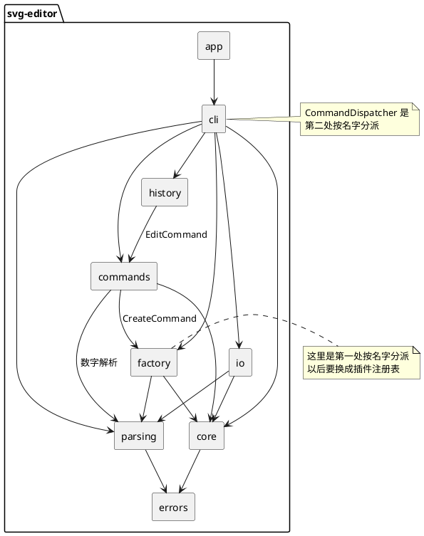

# SVG 编辑器（CLI）架构与实现记录

这份文档记录我在 Lab1 Phase 1 里怎么设计、实现和检查这个 SVG 命令行编辑器。项目用 TypeScript 写，课程要求是用面向对象的方式组织代码，并且必须用 Command 模式实现撤销和重做。

我把文档分成课程要求的四个部分：架构方案、过程记录、一致性自查、质量保证手段。里面写的是最终代码的真实状态，也包括开发过程中真实出现过的问题。

## 一、架构方案

### 1. 模块划分

我把代码按职责分成九个目录。这样分的考虑是：图形本身、命令、文件读写、终端交互这几件事变化的原因不一样，混在一起以后会越来越难改。

| 目录 | 负责什么 | 主要类 |
|---|---|---|
| `src/core` | 图形和画布本身，只关心有哪些图形、怎么嵌套、id 是什么，不关心文件怎么读、命令从哪来 | `Shape`、`RectShape`、`CircleShape`、`EllipseShape`、`LineShape`、`TextShape`、`GroupShape`、`SvgDocument` |
| `src/errors` | 统一的业务异常，异常消息就是 CLI 输出的错误内容，外面只加 `error:` 前缀 | `EditorError` |
| `src/parsing` | 把一行输入拆成命令名、参数和可选的 `in` 子句，不认识任何图形 | `Tokenizer`、`ParsedCommand` |
| `src/factory` | 根据类型名创建图形对象，并检查参数个数和数字格式 | `ShapeFactory` |
| `src/commands` | 十个编辑命令，每个命令自己知道怎么执行、怎么撤销 | `EditCommand` 和十个具体命令类 |
| `src/history` | 管理 undo/redo 两个栈，以及 IO 命令之后的历史锁定 | `HistoryManager` |
| `src/io` | SVG 文件和内存里的文档对象之间互相转换 | `XmlParser`、`SvgReader`、`SvgWriter` |
| `src/cli` | 终端交互：读一行、分发命令、打印结果，另外负责 `tree` 的排版 | `Repl`、`CommandDispatcher`、`TreeRenderer` |
| `src/app` | 程序入口，把模块组装起来并启动 REPL | `App` |

下图是模块之间的依赖关系。箭头表示“可以依赖”，不是数据流。



### 2. 设计模式的选择

#### 2.1 Command 模式

这个 lab 最核心的要求是撤销和重做，而且规定“一条编辑命令就是一个 undo 单元”。我的做法是：每一条编辑命令都写成一个类，类里保存执行所需的数据，并提供 `execute` 和 `undo` 两个方法。

```ts
export abstract class EditCommand {
  abstract execute(doc: SvgDocument): string;
  abstract undo(doc: SvgDocument): string;
}
```

redo 没有另外写一套逻辑，而是直接再调用一次 `execute`。之所以可以这样，是因为 `undo` 已经把文档恢复到执行前的状态，而命令对象里的参数一直保留着。这个做法在单元测试里专门验证过。

不同命令的撤销方式不一样，具体如下：

| 命令 | 执行时做什么 | 撤销时做什么 |
|---|---|---|
| `create` | 检查 id 是否重复，创建图形，挂到指定容器或画布根节点 | 把图形摘下来，同时从 id 索引里删掉 |
| `delete` | 记住原来的父容器和位置，然后删掉整棵子树 | 按原来的位置挂回去，保持图层顺序 |
| `move` | 叶子图形移动自己，容器递归移动所有子孙 | 反向移动同样的距离 |
| `scale` | 先检查缩放系数大于 0，保存整棵子树的几何状态，再递归缩放 | 用保存的状态精确还原，不乘 `1/factor`，避免小数误差 |
| `set` | 检查属性是否允许设置，保存旧值，再赋新值 | 还原旧值；如果原来没有这个属性，撤销后也要变回没有 |
| `group` | 检查成员之间没有祖孙关系，新建容器，把成员按参数顺序放进去 | 每个成员回到原来的父容器和位置 |
| `ungroup` | 把子节点提升到父容器，并放在原来容器所在的位置 | 重新建容器，把子节点按原顺序收回去 |
| `addto` | 检查目标确实是容器，并且不是自己的子孙，然后挂到最后 | 回到原来的父容器和位置 |
| `front` / `back` | 调整同级节点里的顺序 | 回到原来的位置 |

这里有一个我特意坚持的约束：命令执行失败时不能留下半截修改。所有检查都放在真正修改数据之前，只要抛出 `EditorError`，文档和历史栈都不会发生变化。这样用户在终端里输错一条命令，不会出现树结构改了一半的情况。

#### 2.2 Composite 模式

`g` 容器和五种叶子图形都继承同一个 `Shape` 基类。这样 `move`、`scale`、`delete`、`show`、`tree`、保存这些操作，不需要先判断“这是容器还是普通图形”，直接调用对象自己的方法就行。

比如 `translate` 和 `scaleBy`，叶子图形改变自己的坐标，`GroupShape` 则递归调用所有子节点。`SvgDocument` 在挂载和摘除时也会递归处理整棵子树，保证每个 id 都在全局索引里，而且只出现一次。

我还给 `Shape` 加了几个通用方法：`visitSubtree` 用来遍历整棵子树，`isAncestorOf` 用来检查祖孙关系，`captureState` 和 `restoreState` 用来保存和还原状态。这些方法都是多态的，外部代码不需要知道具体是哪种图形。

#### 2.3 Factory 模式

`ShapeFactory` 负责类型名到类的转换。比如输入 `rect` 就创建 `RectShape`，输入 `circle` 就创建 `CircleShape`。参数个数、数字格式也在这一层检查。

课程要求按名字分派只允许出现在两个地方，我严格按这个要求做了：

1. 图形工厂：`ShapeFactory.create` 根据类型名创建对象；
2. 命令分发：`CommandDispatcher.dispatch` 根据命令名调用对应逻辑。

这两处都在代码注释里标了“以后要重构”。第一处以后会换成插件注册表，这样 `box` 这类复合图形可以作为插件加进来，内核不用改。第二处如果以后需要动态注册命令，也可以改成命令表。

除了这两处，代码里没有其他地方根据图形类型或命令名写 `switch`。

#### 2.4 图形的显示和序列化

`tree`、`show`、`save` 三个功能都需要输出图形信息，但格式不一样。我的做法是让每个图形类自己实现三个方法：

- `describe()`：`tree` 里的一行摘要，比如 `x=10 y=20 w=100 h=50 fill=red`；
- `detail()`：`show` 里的多行属性明细；
- `toXml()`：保存成 SVG 时自己负责拼自己的标签。

`TreeRenderer` 只负责画树枝和缩进，`SvgWriter` 只负责拼 `<svg>` 根节点。它们都不需要判断这个图形是 rect 还是 circle。

#### 2.5 状态快照

`scale` 和 `set` 的撤销需要把属性恢复到原来的值。如果 `scale` 的撤销用再乘一次 `1/factor`，小数运算会积累误差，所以我没有这么做，而是在执行前把受影响图形的几何值保存下来，撤销时直接写回。

这个快照只保存一个图形自己的数据，不是把整个文档复制一份。它足够解决当前问题，也没有引入额外的复杂度。

### 3. 依赖方向规则

我给自己定的规则是：依赖只能从容易变化的模块指向稳定的模块。

1. `core` 是最底层，只依赖 `errors`。它不能依赖 `io`、`cli` 或任何命令。
2. `parsing` 只依赖 `errors`，不依赖图形模型。
3. `factory`、`commands`、`io` 只能依赖 `core`、`parsing`、`errors`。其中 `commands` 和 `io` 之间不能互相依赖。
4. `history` 只依赖 `commands` 里的 `EditCommand` 抽象类，不依赖任何具体命令。这样增加新命令时，历史模块不用改。
5. `cli` 是最外层，可以依赖除 `app` 以外的所有模块。
6. 任何模块都不能反过来依赖 `cli` 或 `app`。

这样定规则的直接原因是：图形模型最稳定，终端交互最容易变。把依赖方向固定住以后，改命令、改文件格式、以后加 GUI，都不会影响 `core`。

写完代码以后，我把 `src` 下所有 TypeScript 文件的 import 都扫了一遍，结果如下：

| 模块 | 实际依赖 | 是否符合规则 |
|---|---|---|
| `core/*` | `errors` | 符合 |
| `parsing/*` | `errors` | 符合 |
| `factory/ShapeFactory.ts` | `core`、`parsing`、`errors` | 符合 |
| `commands/*`（11 个文件：1 个抽象类 + 10 个命令） | `core`、`parsing`、`errors`，以及 `CreateCommand` 用到的 `factory` | 符合 |
| `history/HistoryManager.ts` | `commands`、`core`、`errors` | 符合 |
| `io/*` | `core`、`parsing`、`errors` | 符合 |
| `cli/*` | `commands`、`core`、`factory`、`history`、`io`、`parsing`、`errors` | 符合 |
| `app/App.ts` | `cli` | 符合 |

没有发现违反依赖规则的地方。两处按名字分派也都留在计划内的位置，没有扩散到其他模块。

### 4. 变化点假设

我在设计时考虑过以后可能变化的地方，下面按我认为的可能性从高到低排列：

| 可能的变化 | 我留了什么 | 或者为什么暂时不留 |
|---|---|---|
| 增加新的图形类型，比如下一阶段的 `box` | `ShapeFactory` 把类型创建集中在一个地方，并标了以后换成插件注册表；`SvgReader` 对不认识的标签会跳过整棵子树，不会因为多一个标签就崩掉 | — |
| 增加新的操作入口，比如 GUI 或脚本调用 | 编辑逻辑都在 `commands` 和 `history` 里，和终端没有耦合，以后换界面只需要换 `cli` 这一层 | — |
| 修改 `tree` 或 `show` 的显示格式 | 显示内容由各个图形类的 `describe` / `detail` 负责，排版由 `TreeRenderer` 负责，两者分开 | — |
| SVG 语法扩展，比如支持 `transform`、样式表或更多元素 | 读写集中在 `io`；如果真要支持 `transform`，需要改 `Shape` 的坐标含义，这属于领域模型的变化，不是简单加一个解析分支 | — |
| 撤销策略变化，比如支持事务级撤销或历史持久化 | `HistoryManager` 单独成模块，栈的操作都集中在这里 | — |
| 把 id 寻址改成路径寻址，比如 `/canvas/g1/rect[2]` | 暂时不做 | lab 明确说本阶段不要求，这个改动会影响几乎所有命令，现在做只会增加复杂度 |
| 同时打开多个文档 | 暂时不做 | 本阶段的规格就是单文档 REPL，`SvgDocument` 本身没有全局状态，以后真要做，改造成本不算高 |

## 二、过程记录

这一节记录开发过程中比较关键的几次讨论和修改。有些是 AI 给的方案有问题，有些是我自己写代码时没想清楚，都是实际发生过的。

### 1. 先定架构，再写代码

一开始我没有直接让 AI 生成整套代码，而是先让它把模块和命令列出来，我自己对照 lab 文档检查。这样做是因为这个 lab 的评分点很大一部分在结构上，如果先写出一堆能跑但结构混乱的代码，后面再改会更麻烦。

在讨论容器移动和缩放时，AI 给了两个方案：一种是递归修改每个子图形的坐标，另一种是给容器加 SVG 的 `transform`。我一开始觉得 `transform` 更“像 SVG 的做法”，但回头看 lab 文档，`scale` 那一条已经写得很清楚：factor 同乘到图形的全部几何属性，作用于容器时递归到每个子孙。这实际上已经指定了递归修改坐标。

另外，如果使用 `transform`，`tree` 里显示的 x/y 会和实际渲染位置不一致，`set` 子图形的坐标还要做矩阵逆运算，读回文件也要处理多层 `transform` 的叠加。综合下来，递归修改坐标更符合这个阶段的需求，所以最后选了这个方案。

### 2. IO 命令之后的历史栈

lab 规定文档类命令执行后不能 undo/redo，直到下一条编辑命令才重新允许。AI 最初的建议是所有 IO 命令都清空历史栈。我一开始觉得这样最简单，但后来发现有问题。

`init` 和 `read` 会整个替换当前文档对象。历史栈里保存的命令还指向旧文档，如果不清空，下次 undo 就会操作一个已经不在使用的对象，可能直接出错。所以这两个命令必须清空历史。

但 `save` 只是把当前文档写到文件，`canvas` 只是改两个尺寸字段，文档对象还是原来那个。如果这两个命令也清空历史，用户保存一次文件就丢失全部撤销记录，这既不合理，也不符合“下一条编辑命令重新解禁”的意思。

最后我把策略拆开：

- `init` / `read`：清空 undo 和 redo 两个栈，并加锁；
- `save` / `canvas`：只加锁，保留历史；下一条编辑命令成功后解锁，原来的历史还能继续撤销。

这个决定后来写进了 `HistoryManager` 的测试里，四种文档命令的行为都分别验证过。

### 3. 第一次全面检查发现的两个问题

做到第五个提交以后，我停下来把已有代码整体看了一遍，发现两个实际缺陷。

第一个是数字解析。原来直接用 `Number(raw)`，结果空字符串会变成 0，`0x10` 会被当成 16，`Infinity` 和 `NaN` 也会被接受。也就是说，用户输入 `move r1 "" 5` 时不会报错，而是悄悄把 `dx` 当成 0。这不符合坐标是普通十进制数字的约定。我改成了严格的正则匹配，只接受带符号的整数、小数和科学计数法，其他地方一律报 `invalid number`。`core` 里设置属性时用的数字检查也同步收紧了。

第二个是 XML 属性转义。原来只转义了 `&` 和 `"`，没有转义 `<`。如果 id 或 stroke 里出现 `<`，生成的 SVG 在属性值里就是非法字符，浏览器打开会出问题。我补上了 `<` 和 `>` 的转义，并加了对应的回归测试。

### 4. 读取 SVG 时的重复注册

写 `SvgReader` 时，我一开始是先递归读 `g` 的子节点，再把 `g` 本身挂到父节点上。单看 reader 的测试没发现问题，但一做 `save → read → save` 的往返测试就报了 `id already exists`。

原因是子节点在递归时已经注册进全局 id 索引了，等父级 `g` 再挂载时，`SvgDocument` 会把整棵子树重新注册一遍，同一个 id 就出现了两次。

改法是把顺序倒过来：先创建并挂载父节点，再递归处理它的子节点。这样每个节点只注册一次。这个问题让我意识到，单个模块的单元测试通过，不代表模块组合起来一定正确，后面我才专门加了完整的会话回放测试。

### 5. 文本实体、默认尺寸和提示符

同一轮里还修了三个小问题：

1. XML 属性值做了实体反转义，但文本内容没有做，读回来会显示字面的 `&amp;`。改成在元素闭合时统一处理文本实体。
2. 没有 `width` / `height` 时，默认宽度和高度都写成了 800。实际上默认画布是 800×600，应该分别取不同的默认值。
3. 在管道或测试环境里，Node 的 `readline` 不会自动输出提示符，导致回放测试看不到 `svg> `。我改成自己写提示符，这样交互终端和管道里的行为一致。

### 6. `ungroup` 顶层容器的取舍

从使用习惯上看，解散一个直接挂在 `<svg>` 下面的 `g` 是很自然的需求。但 lab 的错误表里明确写了：`ungroup` 根级容器要报 `cannot ungroup top-level container`。

我一开始也觉得这个限制有点奇怪，但最后还是按文档实现了。原因是这个 lab 的验收很大程度上看是否符合规定行为，个人觉得合理不代表可以改规格。这个行为后来也写进了错误表的回放测试。

### 7. `tree` 的对齐方式

lab 示例里的 `tree` 输出对齐不太统一。同样是根级节点，`rect#bg` 后面有 8 个空格，`text#title` 后面只有 5 个。如果完全照着手抄，测试会很难写。

我的处理方式是定一个确定规则：同一父节点下，按最长的“类型#id”计算宽度，后面补两个空格，再输出属性。这样树看起来整齐，输出也可以被测试精确断言。虽然个别空格数和示例不完全一样，但结构和信息是一致的。

### 8. 两个 README 的分工

我一开始把项目说明和课程要求的架构文档混在一起写，仓库首页的 README 里放了开发进度、课程信息这些内容。后来回头检查时发现这样不合适：GitHub 首页的 README 应该像正常项目一样介绍项目本身，而课程要求的过程记录应该放在 `doc/README.md`。

最后我把两个文件分开：

- 根目录 `README.md`：项目简介、安装、使用方式、命令表、项目结构；
- `doc/README.md`：就是现在这份，写架构、过程记录、自查和质量保证。

还有一次提交范围上的小问题：我在提交 README 时，顺手把 factory 目录的占位文件删除也带了进去。功能上没有影响，但提交内容不够干净。后面我改成每次提交都明确指定文件，避免把不相关的变化混进去。

### 9. 用会话回放做最终检查

功能都完成以后，我没有只靠自己手动点几下来确认。我把 lab 文档里的两个完整会话都写成了自动测试：把命令逐行喂给真正的 REPL，然后把输出和预期逐字符比较，包括 `svg> ` 提示符、`warning:` 和 `error:` 行。除此之外，还加了 `other.svg` 读入和错误表的测试。

这样做的好处是，后面再改代码时，只要有一条输出和文档不一致，测试就会失败。对我来说，这比“看起来能跑”更有说服力。

## 三、一致性自查

### 1. 模块划分和实际目录是否一致

一致。实际目录是 `app / cli / commands / core / errors / factory / history / io / parsing`，和前面方案里列的九个模块一一对应。测试目录也按模块分成了 `tests/unit/core`、`tests/unit/parsing`、`tests/unit/factory`、`tests/unit/commands`、`tests/unit/history`、`tests/unit/io`、`tests/unit/cli`，另外还有一个 `tests/integration` 放会话回放测试。

方案里没有写到类这一级，所以有几个模块内部又分了几个类，这不算模块划分变化：

- `cli` 分成 `Repl`、`CommandDispatcher`、`TreeRenderer` 三个类，分别负责循环、分发和树形排版；
- `io` 分成 `XmlParser`、`SvgReader`、`SvgWriter` 三个类，分别负责 XML 解析、读入和写出；
- `core` 在开发过程中补了 `captureState`、`restoreState`、`visitSubtree`、`positionLabel`、`isAncestorOf` 这几个方法，是为了支持撤销、树形显示和祖孙检查，模块边界没有变。

没有发生模块级的新增、删除或改名，所以修订记录里没有需要特别说明的结构变化。

### 2. 依赖方向有没有被违反

没有。我按前面第 3 节的规则，把 `src` 下所有 TypeScript 文件的 import 都检查了一遍，结果也在第 3 节的表里列出来了。

具体来说：

- `core` 只依赖 `errors`，没有反向依赖 `io` 或 `cli`；
- `parsing` 只依赖 `errors`；
- `commands` 和 `io` 之间没有互相引用；
- `history` 只引用 `EditCommand` 这个抽象类，没有引用任何具体命令；
- 没有任何模块反过来依赖 `cli` 或 `app`。

两处按名字分派仍然分别只在 `ShapeFactory` 和 `CommandDispatcher` 里，没有在别的文件里再写一套类型判断或命令判断。

## 四、质量保证手段

我对功能是否完整的判断，主要不是靠自己手动试几条命令，而是看能不能把 lab 文档里的行为稳定地复现出来。具体做了下面这些事。

| 手段 | 具体做了什么 | 结果 |
|---|---|---|
| 单元测试 | 覆盖图形类、文档模型、解析、工厂、十个命令、历史管理和 IO。每个命令都测试成功执行、失败不改状态、撤销还原、重做重放 | 共 155 个测试，全部通过 |
| 会话回放 | 把 lab 第 6 节的完整会话、6.1 的中文流程图会话、`other.svg` 读入和错误表都写成集成测试，逐字符比较 REPL 输出，并检查保存出来的 SVG 内容 | 全部通过 |
| 类型检查 | 使用 TypeScript 的 strict 模式，另外打开了 `noUncheckedIndexedAccess`、`noImplicitOverride`、`noFallthroughCasesInSwitch` | `tsc --noEmit` 零错误 |
| 读写往返 | 对同一份文档执行 `save → read → save`，比较两次输出是否完全一致，覆盖嵌套 `g`、样式、中文文本和小数坐标 | 输出字节级一致 |
| 手动验证 | 在真实终端里逐条执行 lab 会话，用浏览器打开生成的 `demo.svg` 和 `flowchart.svg` 看渲染效果 | 输出和文档一致，图形能正常显示 |
| 失败检查 | 专门测试命令抛错时文档、历史栈和 IO 锁都不变化 | 覆盖 |
| 依赖检查 | 检查所有源文件的 import 方向，并运行 `npm audit` 看依赖安全问题 | 依赖方向没有问题；3 个告警都来自 vitest 的开发依赖，编辑器运行时没有第三方依赖 |
| 提交过程 | 按模块拆成多次提交，每次提交前跑类型检查和测试，确保提交后的代码仍能通过 | 整个过程可以回看，每个阶段都有记录 |

关于 `npm audit` 的那 3 个告警，我单独看了一下：它们都在 `vitest` 和它依赖的测试工具里，而编辑器本身运行时没有引入第三方库。`npm audit` 给出的修复方案是把 `vitest` 降级到一个同样受影响的旧版本，这个方案不能真正解决问题，所以我没有做破坏性的降级，只在文档里记录下来。

总的来说，我认为功能完整性最直接的证据是：lab 文档里的会话可以原样跑通，输出逐字符一致；代码质量的信心则来自严格类型检查、单元测试、集成回放、读写往返和依赖规则检查这几层。现在我还没有发现已知的功能缺口。
